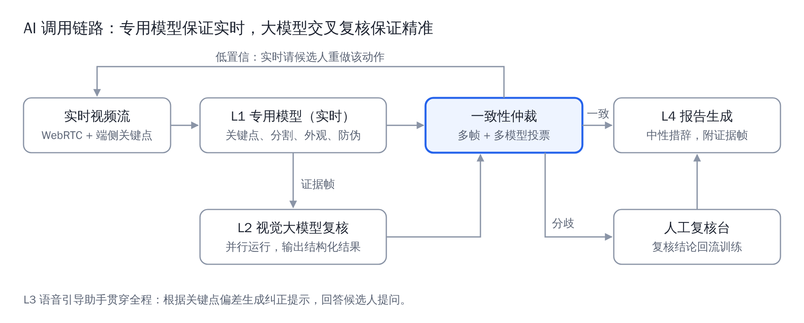

# 远程肢体完整性检测 · M0 验证框架

候选人在家用手机或电脑按语音提示做一组动作，系统检查**手指、四肢、美甲、纹身、疤痕、发色**，生成带证据截图的报告，最终结论由人工确认。用于工厂招聘前的远程筛查。

本仓库是落地前的**技术验证（M0）框架**：用一个网页 demo 采集真实数据，用离线工具在同一批数据上比较不同模型，
按事先定好的指标和通过标准给出“能不能进入下一阶段”的结论。正式产品的实时推流、复核台、身份核验属于 M1 之后的工作。



---

## 落地需要什么指标、什么结果

完整定义、目标值、样本量和计算方法见 **[docs/METRICS.md](docs/METRICS.md)**。最关键的几项（建议值，需与业务方确认）：

| 类别 | 指标 | M0 目标 | 试点目标 |
| --- | --- | --- | --- |
| 准确性 | 手指缺失检出率（没有被自动放行的比例，按会话） | ≥ 90% | ≥ 95%，区间下限 ≥ 90% |
| 准确性 | 健全手误报率 | ≤ 5% | ≤ 3% |
| 准确性 | 四肢判定与人工一致率 | ≥ 95% | ≥ 97% |
| 准确性 | 美甲、纹身、疤痕、发色 | 记录基线 | 有书面依据的项目另定 |
| 准确性 | 需人工复核比例 | 记录 | ≤ 30% |
| 防作弊 | 回放录像被随机挑战拦截 | 100% | 100% |
| 防作弊 | 真人被误拦 | ≤ 5% | ≤ 3% |
| 体验 | 完成率 / 完成时长中位数 | ≥ 90% / ≤ 3 分钟 | ≥ 95% / ≤ 3 分钟 |
| 性能 | 端侧推理 P95 / 大模型单次 P95 | ≤ 100 ms / ≤ 5 秒 | 同左，并给出单卡并发路数 |
| 合规 | 单独同意、外观项书面依据、不自动淘汰、法务审查 | 必须 | 必须 |

**M0 必须拿出的结果**：带置信区间的评测报告（验收标准逐条对照）、模型对比表（MediaPipe / RTMW + SAM 2 / Qwen-VL 8B·32B·72B）、
容量报告（单卡并发与延迟）、漏检误报样本的原因分析、用人方访谈结论。各阶段的出口标准见 METRICS.md 第 2 节，验证怎么做见 **[docs/VALIDATION.md](docs/VALIDATION.md)**。

---

## 仓库结构

```
apps/web-demo/        网页验证 demo：MediaPipe 端侧 L1 + 大模型 L2 + 仲裁 + 报告 + 验证模式（只需 Python 标准库）
limbcheck/            Python 包：检测项、关键点与几何判定、模型适配器、L2 提示词与解析、仲裁、数据集、指标、报告、命令行
  adapters/           模型节点：MediaPipe、RTMW（rtmlib）、肤色 / 分割 / SAM 2 轮廓复核
configs/              所有可调内容（改这里，不改代码）
  checks.json         检测项与拍摄视角定义
  thresholds.yaml     阈值与仲裁参数
  job_profiles/       岗位画像：启用哪些检测项、判定还是只记录、引导步骤、书面依据
  prompts/v1.json     大模型提示词（带版本号）
  pipelines/          离线流水线组合（换模型在这里）
  acceptance.yaml     M0 通过标准
  policies/marks.yaml 纹身 / 疤痕 / 污渍录用标准（招聘方提供，改标准只改这里）
models/               MediaPipe 模型文件（网页和离线共用，已随仓库提供）
deploy/ascend/        昇腾 vLLM-Ascend 部署 Qwen-VL
deploy/rtx/           RTX 6000 上的 RTMW + SAM 2 评测环境
docs/                 PROGRESS（分模块进度）、HANDS（手部完整性与纹身疤痕标准）、GUIDE（术语、判定逻辑与代码详解）、METRICS（指标）、VALIDATION（验证方案）、EXTENDING（扩展与替换）、HANDOFF（项目背景与决策）
tests/                单元测试
```

---

当前进度（按模块逐个完成）见 **[docs/PROGRESS.md](docs/PROGRESS.md)**：第 1 步手部（完整性 + 纹身疤痕录用标准）已完成。

## 快速开始

### 1. 网页 demo（不用安装任何包）

```bash
cd apps/web-demo
python server.py              # Windows 双击 start.bat，macOS 双击 start.command
# 用 Chrome / Edge 打开 http://localhost:8000
```

启用大模型复核：启动前设置 `VLM_BASE_URL` 和 `VLM_MODEL`（内网 Qwen-VL），或只设 `VLM_API_KEY`（默认阿里云百炼 qwen-vl-max）。
详见 [apps/web-demo/README.md](apps/web-demo/README.md)。勾选页面右侧的“验证模式”可以记录受检者真实情况，导出后用于计算指标。

### 2. 离线评测

```bash
pip install -e ".[mediapipe,dev]"       # Linux 还需要：sudo apt-get install -y libegl1 libgles2 libgl1
pytest                                  # 单元测试

# 数据来源一：网页 demo 导出的报告
limbcheck import-demo reports/*.json -o data/m0
limbcheck score --data data/m0 --run runs/m0-browser          # 浏览器端结果的指标

# 数据来源二：已有图片文件夹 + 标注表
limbcheck labels-template photos/ -o labels.csv               # 生成标注表，用 Excel 填写
limbcheck import-folder photos/ --labels labels.csv -o data/photos

# 跑流水线、出报告（report.md 第一张表是验收标准对照）
limbcheck eval --data data/m0
limbcheck eval --data data/m0 --pipeline configs/pipelines/keypoints-only.yaml
limbcheck compare runs/<运行1> runs/<运行2> -o runs/compare.md

# 其他
limbcheck synth-missing --data data/m0 -o data/m0-synth       # 在健全手上合成缺指样本（仅作参考）
limbcheck vlm-probe --image 手背.jpg --view backs --vlm-base-url http://...:8001/v1 --vlm-model Qwen/Qwen3-VL-8B-Instruct
limbcheck viz --data data/m0 --run runs/<运行> --only misses   # 把漏检逐张画出来
limbcheck list                                                 # 列出所有可替换节点、岗位、流水线
```

---

## 判定规则要点

- **L1 专用模型**：关键点 + 规则（手指长度比、四肢可见度与左右比、指甲色差），手指另有**轮廓复核**（指尖处是否真的有皮肤），用来发现关键点模型“脑补”出的手指。
- **L2 视觉大模型**：每个视角一张证据截图，按固定 JSON 输出；只评估本次启用的项目，不评价性别、年龄、肤色等无关属性。
- **仲裁**：任何一路认为有问题 →“疑似问题·待人工确认”；两路矛盾或置信度低 → 人工复核（或请候选人重做一次）；只有都认为正常且置信度高才自动“满足”。**系统不输出最终“不通过”**。
- **纹身、疤痕**按招聘方书面录用标准（`configs/policies/marks.yaml`）逐处判定：部位、攻击性内容、以身份证 / 1 分硬币为参照的面积、颜色深浅、手指数量、疤痕形态；疑似污渍提醒清洁重拍。详见 **[docs/HANDS.md](docs/HANDS.md)**。
- **发色**在没有书面岗位依据前只记录、不判定（岗位画像的 `basis` 为空时，配置加载会强制降级）。
- 左右一律指受检者本人的左右。网页画面显示时做了镜像，但截图和计算用的都是未镜像的原始画面。

不常见的术语（ΔE、掩码、叉积、Wilson 区间、κ 等）、每一步判定的公式和算例、仲裁决策表、指标算法和代码逐模块讲解，
见 **[docs/GUIDE.md](docs/GUIDE.md)**。

---

## 可替换、可修改的节点

需求变化时，大多数改动只改 `configs/`：阈值、仲裁参数、提示词版本、大模型地址、关键点 / 轮廓 / 分割模型、岗位画像、验收标准，
甚至**新增一个检测项**（只靠大模型时不用写代码，有测试验证）。需要写代码的地方（新的 L1 算法、新模型适配器、自定义仲裁策略）
都通过注册表以插件方式接入，不改核心代码。逐项说明见 **[docs/EXTENDING.md](docs/EXTENDING.md)**。

---

## 验证状态

| 已验证 | 说明 |
| --- | --- |
| 单元测试 111 项 | 纹身疤痕录用标准逐条、跨视角计数、掌面残缺、尺度估算、几何判定、轮廓复核、仲裁、提示词解析、大模型客户端（模拟服务）、数据导入、指标、配置、流水线、网页服务端、“只改配置新增检测项” |
| MediaPipe 左右手与掌心 / 手背判定 | 用 MediaPipe 官方测试图核对（未镜像照片上模型给出的就是本人左右） |
| 网页 demo 全流程 | 无头浏览器 + 模拟摄像头 + 模拟大模型：精密装配、仓储搬运两个岗位跑完，导出报告 → 导入 → 出指标 → 离线重跑 → 对比；颈部、双臂近景步骤、纹身疤痕核验表、污渍清洁提醒与重拍已跑通 |
| 离线评测链路 | 标注表导入 → 合成缺指 → 三种流水线评测 → 对比报告 |

| 尚未验证 | 原因 / 下一步 |
| --- | --- |
| 真实摄像头、真人、真实缺指样本 | 需要志愿者实测（VALIDATION.md）和合作机构样本 |
| RTMW、SAM 2 | 开发环境无法下载模型权重；代码已写，需在 RTX 6000 上首跑（deploy/rtx） |
| 昇腾部署 Qwen-VL | 开发环境无 NPU；脚本已写（deploy/ascend），需确认型号与 CANN 版本 |
| 阈值 | 目前是经验初值，必须用 M0 校准集校准（VALIDATION.md 第 7 节）；美甲色差法在合成数据上误报偏多 |

合成数据上的小样本结果（30 张合成缺指 + 3 张原图，仅示意，不能作为结论）：关键点单独检出 30%，加肤色轮廓复核 60%，
加分割轮廓 93%（但原图误报 2/3）。这说明关键点模型确实会“脑补”手指，轮廓复核和大模型复核是必要的。

---

## 常见问题

- **`libEGL.so.1: cannot open shared object file`**：Linux 上 MediaPipe 需要 `sudo apt-get install -y libegl1 libgles2 libgl1`。
- **必须 `pip install -e .`**：配置文件按仓库目录查找；不在仓库里运行时设 `LIMBCHECK_CONFIG_DIR` 指向 `configs/`。
- **模型下载不了**：MediaPipe 模型已在 `models/`；RTMW / SAM 2 的离线用法见 `deploy/rtx/README.md`。
- **改了阈值或岗位，网页没变化**：运行 `limbcheck export-web-config` 重新生成网页配置。
- **数据安全**：`data/`、`runs/`、`viz/`、`reports/` 和导出的报告文件已加入 `.gitignore`，含受检者影像，不要提交。

## 合规提醒

人脸、身体影像、残疾和健康信息属于敏感个人信息，需要单独书面同意；手指、四肢只判断“能否完成岗位操作”；
外观项必须有书面依据；系统不自动淘汰，提供人工复核、线下替代和申诉渠道；上线前请劳动法律师审阅。详见 docs/HANDOFF.md 第 7 章。
