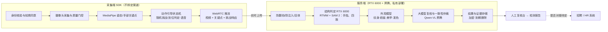
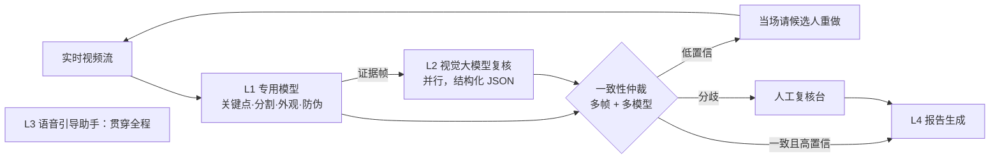
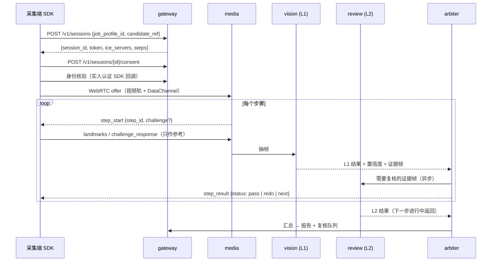

# 远程肢体完整性检测系统 · 项目交接文档

> **说明（仓库版）**：本文是项目交接时的规划文档，保留原文供查阅背景、决策记录和待定讨论点。
> 第 9 章“代码方案”和第 10 章“现有 demo”已由本仓库实现并取代，现状以仓库根目录 README.md、
> docs/METRICS.md、docs/VALIDATION.md、docs/EXTENDING.md 为准。架构图和链路图见 docs/images/。


> 版本 1.0 · 2026-10-25 · 项目负责人：Warren
> 用途：把项目的全部背景、决策、技术方案和代码方案交给新的 Agent 或工程师，读完即可继续工作。
> 约定：**已确定**的内容标"已确定"；**建议**是项目组的推荐，尚未拍板；**待定**需要项目负责人或业务方回答；**估计**是没有公开来源的经验数字，必须实测。

---

## 0. 给接手 Agent 的说明

### 0.1 阅读顺序
1. 第 1–2 章：项目是什么、已经定了什么。
2. 第 9 章：代码方案，这是动手的主要依据。
3. 第 10 章：现有 demo 的实现细节，它是第一版代码的起点。
4. 第 15 章：接手后的待办清单（含验收标准）。

### 0.2 工作原则（必须遵守）
- **对用户使用中文**，结论先行，术语第一次出现时给出解释。
- **不编造精度数字**。公开指标只能引用来源；本场景的检出率、误报率、延迟、并发都必须实测后才能写成结论。
- **人在回路**：系统只给"满足 / 需人工复核"的建议，所有不通过和疑似项都由人确认，系统不自动淘汰候选人。
- **视觉大模型只做第二意见**，不能单独定论；数手指是它的已知弱项。
- **数据不出内网**：真实候选人数据只能送到自有服务器上的模型，不得调用境外模型 API。
- **原始视频不落盘**，只保存证据帧和结构化结果。
- **许可证**：优先 Apache-2.0 / MIT 模型。YOLO11（AGPL-3.0）商用需购买 Ultralytics 企业许可；Sapiens、HaMeR（依赖 MANO）商用前必须核实。
- **合规提示不等于法律意见**，涉及法律判断时建议用户请律师确认。

### 0.3 交接包里的文件
| 文件 | 内容 |
| --- | --- |
| `HANDOFF.md` | 本文档 |
| `limb-check-demo/` | 本地验证 demo 源码（浏览器 + Python 标准库服务），已含模型和运行库 |
| `远程肢体完整性检测-立项准备报告.docx` | 立项准备报告（24 页），面向评审会 |
| `diagrams/arch.png`、`diagrams/chain.png` | 系统架构图、AI 调用链路图 |

在线文档（需要项目负责人的 claude.ai 账号权限）：
- 项目规划：https://claude.ai/artifact/V72WnMSmvRpf3bExEFTaej （注意：其中检测范围是 10 月 21 日的精简版，已被推翻，以本文档为准）
- 模型选型对比（含代码示例）：https://claude.ai/artifact/YV626Vh6on6HvmxuGJhYTQ

---

## 1. 项目概述

### 1.1 一句话
候选人在家用手机或电脑，按语音和动画提示完成一组动作；系统实时检查**手指、四肢、美甲、纹身、疤痕、发色**，生成带证据截图的检测报告，最终结论由人工确认。用于工厂招聘前的远程筛查。

### 1.2 目标
- **能力**：覆盖六项检查，每个动作完成时给出结果（实时）。
- **精准**：专用模型 + 视觉大模型交叉复核；"不通过"要求高精度，疑似项转人工。
- **体验**：全程语音引导，目标 3 分钟内完成。
- **形态**：检测能力封装为 SDK + API，不绑定渠道，后续可接 App、小程序或 HR 系统。

### 1.3 检测范围（已确定六项全做）
| 检测项 | 检查内容 | 主要技术 | 成熟度 | 说明 |
| --- | --- | --- | --- | --- |
| 手指 | 数量、指节完整、屈伸、拇指对捏 | 手部关键点 + 轮廓分割 + 大模型复核 | 高 | 缺指检出率需实测；关键点会"脑补"缺失手指 |
| 四肢 | 是否完整、左右长度比、关节活动范围 | 人体姿态关键点 + 规则 | 高 | — |
| 美甲 | 甲油、甲片、延长甲 | 指甲裁剪 + 分类器 / 大模型 | 中高 | 透明、裸色甲难识别 |
| 纹身 | 可见部位纹身的位置和面积 | 分割模型 / 大模型 | 中 | 需要书面判定依据 |
| 疤痕 | 可见部位疤痕的位置和面积 | 分割模型 / 大模型 + 人工 | 中低 | 最难，易与痣、胎记、淤青混淆；需要书面判定依据 |
| 发色 | 自然、染色、挑染 | 头发分割 + 颜色分析 / 大模型 | 中高 | 受光线和白平衡影响；需要书面判定依据 |

纹身、疤痕、发色与岗位操作能力关联较弱，必须有明文依据（岗位规范、安全卫生规定、客户审核要求等）才适合作为判定条件。依据未落实前，代码里这三项默认"只记录、不判定"（见 9.6 的 `mode` 配置）。

### 1.4 不在本期范围
- 医学诊断或职业健康体检结论。
- 线下检测点专用硬件、原生 App 上架。
- 与招聘 / HR 系统的深度对接（待定，见讨论点 2）。

---

## 2. 决策记录

| 日期 | 决策 | 状态 |
| --- | --- | --- |
| 10-21 | 先不绑定渠道，先完善检测能力；Web 只作开发和演示外壳 | 已确定 |
| 10-21 | 场景：候选人在家远程自助完成，无人在场 | 已确定 |
| 10-21 | 处理方式：可以上传服务器，但全程实时分析 | 已确定 |
| 10-21 | 用途：工厂招工筛查 | 已确定 |
| 10-21 | 曾决定"按岗位要求精简"（只查手指、四肢、美甲提醒） | **已撤销**（10-22） |
| 10-22 | 不受之前精简决定约束，六项检查全部纳入；纹身、疤痕、发色标注"需要书面依据" | 已确定 |
| 10-21 | 精准与智能化：允许增加 AI 大模型调用链路 | 已确定 |
| 10-23 | 现有算力：8 卡昇腾 + 双卡 RTX 6000（48 GB） | 已确定（昇腾具体型号待确认） |
| 10-23 | 全部模型私有部署，数据不出内网 | 建议 |
| 10-23 | 模型组合：端侧 MediaPipe；服务端 RTMW / RTMPose + SAM 2；大模型 Qwen-VL（昇腾） | 建议，M0 实测后定型 |
| 10-23 | 系统不自动淘汰，结论由人确认，提供线下替代和申诉 | 建议 |

注意：**现有 demo 是在 10-21 精简范围下写的**，同意书文字和大模型提示词里明确写了"不检测纹身、发色、疤痕"，扩展到六项时必须同步修改（见 10.5）。

---

## 3. 业务流程与引导动作

### 3.1 整体流程
1. HR 发起检测邀请，候选人通过链接进入（渠道待定）。
2. **身份核验与知情同意**：身份证 + 人脸比对；单独授权后才开启摄像头。
3. **环境准备**：设备放在 2–2.5 米外固定，检查光线、背景、单人、全身入框。
4. **引导动作**：按语音和动画提示完成动作，中间随机插入挑战。
5. **实时判定**：每个动作完成时出结果；置信度低时当场请候选人重做。
6. **人工复核**：不通过和疑似项进入复核台，复核员确认。
7. **报告与申诉**：生成检测报告；候选人可以申诉或改约线下面检。

### 3.2 动作步骤（建议，10 步，目标 3 分钟内）
| 步骤 | 动作 | 主要画面 | 服务的检测项 |
| --- | --- | --- | --- |
| 0 | 环境准备：设备固定，后退到全身入框 | 全身 | 质量门控：光线、清晰度、单人、入框 |
| 1 | 正面站立，双臂自然下垂 | 正面全身、头部 | 四肢完整、长度比；发色；面颈部纹身和疤痕 |
| 2 | 原地转身，背对镜头站立 | 背面全身、头部 | 发色；颈后、手臂背侧纹身和疤痕 |
| 3 | 双臂侧平举，再上举过头 | 上肢全长、手臂内侧 | 上肢完整、肩肘活动；手臂纹身和疤痕 |
| 4 | 走近镜头，双手掌心朝前、五指张开 | 双手掌心近景 | 手指数量与指节；掌面疤痕 |
| 5 | 翻转为手背朝前 | 双手手背近景 | 美甲；手背纹身和疤痕；翻转校验真实动作 |
| 6 | 握拳后张开，再做随机手势（如"比 3"） | 手部动态 | 手指屈伸；活体 |
| 7 | 拇指依次与其余四指对捏 | 手部动态近景 | 精细操作能力 |
| 8 | 退回原位，单腿依次抬起 | 下肢全长 | 下肢完整、膝髋活动；小腿纹身和疤痕（视着装） |
| 9 | 深蹲后起立 | 全身动态 | 整体运动能力 |

规则：动作到位并保持约 1 秒自动进入下一步；不到位实时语音纠正；部分步骤随机打乱顺序；随机手势挑战要求 5 秒内完成；不同岗位可以只启用部分步骤。着装默认短袖，是否检查腿部和躯干待定（讨论点 3）。

---

## 4. 系统架构

### 4.1 三层结构
**端侧实时引导 + 服务端实时分析 + 人工复核**。端侧只跑轻量关键点模型，保证引导延迟在 100 ms 以内；视频经 WebRTC 实时推到服务端，重模型在 GPU 上抽帧推理，每个动作结束前出结果。**端侧不做最终判定，服务端是唯一可信来源**。



### 4.2 AI 调用链路
精准靠两套独立判断交叉验证；智能靠低置信时当场重做和全程语音纠正。L2 在候选人做下一个动作时并行复核上一个动作，候选人感知仍是实时。



| 层 | 做什么 | 模型 | 运行位置 | 延迟 |
| --- | --- | --- | --- | --- |
| L1 专用模型 | 关键点、手部分割、外观检测、翻拍和注入检测，给出初判和置信度 | MediaPipe、RTMW / RTMPose、SAM 2、外观分割模型 | 端侧 + RTX 6000 | 毫秒级 |
| L2 视觉大模型复核 | 每步挑 2–3 张证据帧（可叠加关键点），连同判定标准发给大模型，按固定 JSON 输出：是否满足、置信度、理由 | Qwen-VL 系列 | 昇腾 | 1–5 秒（估计），并行不阻塞 |
| 一致性仲裁 | 一致且高置信 → 采纳；低置信 → 当场重做；仍有分歧 → 转人工 | 规则引擎 | 服务端 | 毫秒级 |
| L3 语音引导 | 关键点偏差转自然语言纠正，回答候选人提问 | 模板 + 文本小模型 + 语音合成 | 昇腾 / 端侧 | 1 秒内 |
| L4 报告与复核助手 | 汇总结果生成报告，给复核员列出分歧点和证据帧 | 文本大模型 | 昇腾 | 结束后数秒 |

**大模型护栏**：只能按预定义 JSON 输出，解析失败视为"需复核"；只评价本次启用的检测项，不输出性别、年龄、民族等无关属性；不单独定论；每次调用记录输入、输出、模型和提示词版本；更换模型或提示词前先在验证集跑回归；人工复核结论回流为标注数据。

### 4.3 防作弊
核心思路："随机挑战 + 实时响应 + 身份绑定"。
- **身份核验**：开始前身份证 + 人脸比对；过程中持续比对人脸、跟踪同一人体，出现第二个人即暂停。建议采购阿里云或腾讯云的实人认证 SDK。
- **随机挑战**：服务端下发一次性随机动作和手势（种子只在服务端），校验响应时延。
- **时序一致性**：关键点轨迹必须连续、符合人体运动学，帧间跳变判可疑。
- **翻拍检测**：屏幕摩尔纹、边框、反光分类器。
- **防视频注入**：识别虚拟摄像头设备和注入痕迹，接入深度伪造检测；风险分高时转人工视频连线。浏览器无法彻底屏蔽虚拟摄像头，原生 App 更可靠。
- **线下抽检**：入职当天抽检远程结果。

### 4.4 隐私设计
- 视频流在服务端实时处理后丢弃，不落盘；只保存证据帧和结构化结果。
- 证据帧加密存储，按角色授权查看，审计日志，到期自动删除（默认 30 天，待定）。
- 外观类证据帧只裁剪相关部位，报告不展示无关身体部位。

---

## 5. 模型选型

### 5.1 结论（建议）
不需要在专用模型和大模型之间二选一：结构类（四肢、手指）用专用模型；外观类（纹身、疤痕、美甲、发色）先用视觉大模型起步，积累数据后训练专用小模型替代。

| 环节 | 模型 | 运行位置 |
| --- | --- | --- |
| 实时引导、动作到位判断 | MediaPipe Pose + Hands | 候选人手机或浏览器 |
| 四肢和手指关键点精判 | RTMW（全身 133 点）+ RTMPose-hand（手部近景） | RTX 6000 |
| 手指轮廓复核 | SAM 2.1 tiny，用手部关键点做提示点 | RTX 6000 |
| 纹身、疤痕、美甲、发色 | 前期 Qwen-VL；数据够了换 YOLO11-seg 或 MMSegmentation 微调模型 | 前期昇腾，后期 RTX 6000 |
| 防翻拍、防注入、实人认证 | 采购成熟 SDK + 自研翻拍分类器 | SDK 服务 + RTX 6000 |
| 第二意见与报告 | Qwen3-VL 或 Qwen2.5-VL，私有部署 | 昇腾 |

### 5.2 候选模型速查
| 模型 | 类型 | 效率 | 公开精度 | 许可 | 定位 |
| --- | --- | --- | --- | --- | --- |
| MediaPipe Pose / Hands | 关键点 | 手机 5–25 ms | 配合拍摄下 PCK@0.2 90–97% | Apache-2.0 | 端侧引导（demo 已用） |
| RTMPose / RTMW | 关键点（RTMW 含手指） | CPU 35 ms，GPU 数百 FPS | COCO AP 75.8；全身 AP 70.2 | Apache-2.0 | 服务端主力，可微调 |
| YOLO11-Pose | 关键点 | T4 1.7–12 ms | COCO 50.0–69.5 | AGPL / 企业许可 | 备选 |
| ViTPose | 关键点 | A100 241–944 FPS | COCO 75.8–80.9 | Apache-2.0 | 离线复核、生成标注 |
| HaMeR | 3D 手部重建 | 重，需 GPU | FreiHAND PA-MPJPE 6.0 mm | 依赖 MANO，非商用 | 不建议（五指模板会补全缺指） |
| SAM 2.1 | 通用分割 | A100 40–91 FPS | 零样本分割 | Apache-2.0 | 手指轮廓复核 |
| Sapiens | 人体部位分割 | 很重（0.3B–2B） | 部位分割 mIoU 81.2 | 自有协议，需核实 | 关键帧头发、部位分割 |
| YOLO11-seg | 实例分割 | T4 1.8–16 ms | COCO mask 32.0–43.8 | AGPL / 企业许可 | 外观项微调底座 |
| Qwen3-VL / Qwen2.5-VL | 视觉大模型 | 秒级 | CountBench 80–95 | 开源 | 外观判断、第二意见、预标注 |

视觉大模型在昇腾上的支持情况（vLLM-Ascend v0.18.0 支持列表，Atlas A2/A3）：Qwen2.5-VL 已支持（含 W8A8 量化）；Qwen3-VL 稠密版已支持，MoE 版实验性；InternVL、GLM-4.xV 暂不支持。ms-swift 支持在昇腾上对 Qwen2.5-VL 等做 LoRA 微调。

### 5.3 公开指标怎么读（用户问过，接手后可能还会问）
- **PCK@0.2**：预测点与标注点距离不超过躯干长度的 20% 算"找对"，PCK 是找对的比例。MediaPipe 的 "Full 95.5–96.3%" 是三个测试集（瑜伽、舞蹈、HIIT）的最低到最高。
- **COCO AP / mAP50-95**：先用 OKS（关键点相似度 0–1，考虑人体尺度和各部位容错）判断一个人的整套关键点对不对，在 OKS 0.50–0.95 共 10 档阈值下算准确率再平均。测试集是多人、遮挡的自然场景，比本项目难，75.8 不代表 24% 的点错了。
- **模型尺寸字母**：YOLO 的 n/s/m/l/x = nano/small/medium/large/extra-large；RTMPose 的 s/m；RTMW 的 l/x；ViTPose 的 B/L/H = Base/Large/Huge；MediaPipe 的 Lite/Full/Heavy。"n 50.0" 即最小版 AP 50.0。越大越准越慢。
- **256×192 / 384×288**：输入分辨率（高×宽）。**ms** 是单张耗时，**FPS** 是每秒张数，FPS ≈ 1000 ÷ ms。
- **MediaPipe Hands**："手掌检测 AP 95.7%" 只衡量能否找到手；"关键点误差约为手掌尺寸的 10%" 约 1 cm。
- **RTMW 手部 AP 66.3–66.4**：同 COCO AP 算法，只统计双手 42 点；全身画面里手小所以低。
- **HaMeR**：PA-MPJPE 是对齐后每个关节平均误差（mm，越小越好）；F@15mm 是表面点在 15 mm 内的比例（满分 1）。
- **关键提醒**：所有公开测试集里的手都是五指健全的，这些分数都不能说明"缺指能不能检出"，必须用自己的数据测。

### 5.4 微调预期（估计，无公开基准）
| 检测项 | 开箱即用 | 微调后预期 | 所需标注 | 推荐底座 |
| --- | --- | --- | --- | --- |
| 四肢 | 已可用 | 一般不需微调 | 验证集 200–500 人次 | MediaPipe Pose / RTMPose |
| 手指缺失 | 健全手准；缺指易被"脑补" | 三路交叉后召回有望 ≥ 90%，余下人工 | 真实缺指数百例 + 合成数千例 | RTMPose-hand 微调 + SAM 2 |
| 美甲 | 色差法对深色有效 | 不透明甲油、甲片约 95%+；透明、裸色明显更低 | 约 5,000 张指甲裁剪图 | MobileNet / YOLO11-cls |
| 纹身 | 大模型对大面积深色可用 | 明显纹身检出约 90% | 3,000–5,000 张掩码 | YOLO11-seg / MMSegmentation |
| 疤痕 | 大模型误报多 | 明显大疤痕约 80%，小疤痕靠人工 | 3,000 张起 | YOLO11-seg / MMSegmentation |
| 发色 | 分割 + 颜色分析可用 | 自然与明显染色区分约 90%+ | 约 2,000 张 | Sapiens 头发分割 + 分类器 |
| 视觉大模型 | 提示词即可复核 | LoRA 后一致性、格式稳定性明显提升 | 几千条"图片 + 标准答案" | Qwen3-VL 8B（ms-swift，可在昇腾训练） |

三条规律：数据比模型重要；外观类先大模型、后小模型；阈值按"漏检代价"调，宁可多报"需复核"。

---

## 6. 算力与部署

| 资源 | 承担的工作 | 原因 |
| --- | --- | --- |
| 双卡 RTX 6000（48 GB，CUDA） | L1 实时推理：RTMW / RTMPose、SAM 2、外观分割与分类、翻拍和注入检测；小模型训练微调；开发期可跑 Qwen-VL 8B 做对照 | 视觉模型工具链（ONNX Runtime、TensorRT、MMPose、Ultralytics、SAM 2）在 CUDA 上最成熟 |
| 8 卡昇腾（型号待确认） | L2 视觉大模型；L3、L4 文本模型；大模型 LoRA 微调 | vLLM-Ascend 支持 Qwen-VL；ms-swift 支持 NPU 微调 |

昇腾分配建议（按单卡 64 GB 的 910B 估算，**待确认型号**；若单卡 32 GB，32B 模型需 4 卡或量化）：
- **M0**：2 卡 Qwen3-VL-32B（BF16，TP=2）、1 卡 Qwen3-VL-8B、4 卡 Qwen2.5-VL-72B，对比精度和延迟后定型；1 卡调试。
- **试点**：选定模型 2–3 个实例做 L2；1–2 卡文本模型做 L3、L4；2 卡留作 LoRA 微调。

其他：若有国产化（信创）要求，L1 也要迁到昇腾（ONNX Runtime 的 CANN 执行器为社区维护、算子覆盖有限，SAM 2 等需额外移植）。候选人从公网接入，需要公网带宽、域名证书、TURN 中继；按 720p 每路约 1.5–2.5 Mbps 估算上行带宽。容量上限待 M0 压测。

---

## 7. 数据、合规与风险

### 7.1 数据需求（估计）
| 数据 | 来源 | 标注方式 | 规模 |
| --- | --- | --- | --- |
| 姿态 / 手部关键点 | 开源预训练模型 | 只做本场景验证集 | 验证集约 500 人次 |
| 手指 / 肢体缺失 | 合作机构采集 + 合成（图像编辑隐藏手指） | 逐指、逐肢体"存在 / 缺失 / 不可见" | 真实数百例 + 合成数千例 |
| 岗位动作 | 内部员工自愿录制 | 动作是否完成、关节角度 | 约 200 人次 |
| 美甲 | 自采 | 每个指甲一个类别 | 约 5,000 张 |
| 纹身 | 自采 + 公开数据集（需核实授权） | 掩码 | 3,000–5,000 张 |
| 疤痕 | 合作机构 + 自采 | 掩码，区分疤痕、痣、胎记、淤青 | 3,000 张起 |
| 发色 | 自采 | 自然 / 染色 / 挑染 | 约 2,000 张 |
| 翻拍 / 注入攻击 | 自建 | 真人 / 攻击 | 数百段视频 |

要求：覆盖不同肤色、年龄、体型、光照；全部书面授权；试点期复核结论直接作为标注；大模型预标注 + 人工确认。

### 7.2 合规要点（非法律意见）
- 人脸、身体影像、残疾和健康状况属于《个人信息保护法》第 28 条的敏感个人信息；第 29 条要求单独同意；第 30 条要求告知必要性和对个人权益的影响。
- 《就业促进法》第 29 条：用人单位招用人员不得歧视残疾人。手指、四肢只判断"能否完成岗位操作"，报告不用"残缺"等措辞。
- 《劳动合同法》第 8 条：用人单位有权了解劳动者"与劳动合同直接相关的基本情况"。纹身、疤痕、发色需有书面依据，否则建议只记录、不作为淘汰条件。
- 最小必要；标准提前公开；可随时中止；线下替代渠道；申诉；境内私有部署；上线前请劳动法律师审阅。

### 7.3 主要风险
| 风险 | 可能性 | 影响 | 应对 |
| --- | --- | --- | --- |
| 判定标准和外观项依据迟迟定不下来 | 中 | 高 | 立项会定负责人和截止时间；外观项先"只记录" |
| 外观项被质疑歧视或过度收集 | 中 | 高 | 明文依据、律师审查、标准公开、不自动淘汰 |
| 缺指被关键点"脑补"导致漏检 | 高 | 高 | 关键点 + 分割 + 大模型三路交叉；低置信转人工 |
| 远程代测或视频注入 | 中 | 高 | 实人认证 SDK、随机挑战、视频连线、入职抽检 |
| 缺失、疤痕真实样本不足 | 高 | 中 | 合作机构、合成数据、复核回流 |
| 家庭环境画质差 | 高 | 中 | 环境准备、质量门控、重做、报告标出画质不足 |
| 昇腾软件栈适配 | 中 | 中 | 优先 vLLM-Ascend 已支持的 Qwen-VL；必要时临时放 RTX 6000 |
| 模型许可 | 中 | 中 | 优先 Apache-2.0；YOLO11、Sapiens 商用前核实 |
| 证据数据泄露 | 低 | 高 | 视频不落盘、加密、按角色授权、审计、到期删除 |

---

## 8. 里程碑与 M0 验证

| 阶段 | 时间 | 主要工作 | 出口标准 |
| --- | --- | --- | --- |
| M0 技术验证 | 第 1–2 周 | 用人方访谈；demo 实测；昇腾部署 Qwen-VL 对比 8B/32B/72B；RTMW 与 SAM 2 对比；外观项基线；压测 | 达到下表通过标准 |
| M1 核心能力 | 第 3–8 周 | WebRTC 推流与服务端实时推理；手指、四肢判定；身份核验与防作弊 v1；L1/L2 仲裁 | 内部 50 人次测试达标 |
| M2 外观能力 | 第 7–14 周 | 美甲、发色、纹身、疤痕：大模型起步 + 采集标注 + 小模型微调 | 外观项验证集指标达标 |
| M3 复核台与报告 | 第 11–16 周 | 复核台、报告、管理后台（待定）；同意书与合规材料 | 律师审查通过 |
| M4 单厂试点 | 第 17–22 周 | 一家工厂、一个岗位；全量人工复核；数据回流 | 试点评估 → 推广决策 |

团队：项目经理 / 产品 1（可兼）、算法 1–2、前后端 1、运维 0.5（兼）、标注外包、法务按需、试点复核员 1–2。外观项若最终不纳入，整体约 4 个月。

**M0 通过标准（建议值，需与业务方确认）**
| 验证项 | 方法 | 建议标准 |
| --- | --- | --- |
| 手指缺失检出 | 20–30 名志愿者在家实测：藏一根手指、用肤色胶带遮半截手指 | L1 + L2 召回 ≥ 90%；健全手误报 ≤ 5% |
| 四肢与动作 | 同一批人，不同光线、距离、背景 | 动作到位判定与人工一致率 ≥ 95% |
| 外观项基线 | Qwen-VL 开箱判断四类外观样本，对比人工标注 | 记录基线，不设门槛 |
| 防回放与注入 | 手机回放预录视频；虚拟摄像头注入 | 回放全部被随机挑战拦截；注入检出如实记录 |
| 延迟 | 端到端测量 | 端侧引导 ≤ 100 ms；L2 在下一步结束前返回 |
| 容量 | RTX 6000 与昇腾压测 | 得出单卡并发路数和单次资源占用 |
| 体验 | 记录时长和重做次数 | 完成时长中位数 ≤ 3 分钟 |

---

## 9. 代码方案（建议设计，尚未实现）

> 本章是正式系统的设计。现有可运行代码只有第 10 章的 demo。实现时以本章为蓝图，以 demo 为算法起点。

### 9.1 技术栈
| 部分 | 选型 | 理由 |
| --- | --- | --- |
| 采集端 SDK | TypeScript；`@mediapipe/tasks-vision`；原生 WebRTC | demo 已验证可行；后续 App 可用 MediaPipe 原生 SDK 复用同一套步骤定义 |
| 实时媒体 | M0/M1 原型用 `aiortc`；试点起建议评估 LiveKit（自托管 SFU，自带 TURN 和断线重连，有 Python SDK 订阅视频轨） | 少维护信令和 TURN |
| 业务服务 | Python 3.11 + FastAPI + Pydantic v2 | 与推理代码同语言，模型和规则共享数据结构 |
| L1 推理 | `rtmlib`（RTMW / RTMPose，ONNX Runtime GPU，后续可换 TensorRT）；`sam2`；外观模型用 Ultralytics（有企业许可时）或 MMSegmentation | 见第 5 章 |
| L2 / L3 / L4 | vLLM-Ascend 提供 OpenAI 兼容接口；客户端用 `openai` Python SDK | 与 demo 的 `server.py` 接口一致，切换只改地址 |
| 存储 | PostgreSQL（会话、结果、审计）；MinIO（S3 兼容，证据帧，服务端加密）；Redis（任务队列、会话状态） | 均可私有部署 |
| 复核台 | React + TypeScript | — |
| 训练与评测 | MMPose、ms-swift、Ultralytics / MMSegmentation；自建评测脚本 | — |
| 部署 | Docker Compose（M0–M1）→ Kubernetes（试点后） | — |

### 9.2 仓库结构
```
limb-check/
├── sdk/web/                    # 采集端 SDK（TypeScript）
│   ├── src/capture/            # 摄像头、质量门控（亮度、模糊、入框）
│   ├── src/landmarks/          # MediaPipe 封装（Pose、Hands）
│   ├── src/engine/             # 动作引导状态机（与服务端共享步骤定义）
│   ├── src/transport/          # WebRTC 推流 + DataChannel 协议
│   ├── src/voice/              # 语音提示（TTS 模板）
│   └── demo/                   # 演示外壳页面
├── services/
│   ├── gateway/                # FastAPI：会话、同意、身份核验回调、报告查询、鉴权
│   ├── media/                  # WebRTC 接入，解码，按步骤抽帧，分发给推理
│   ├── vision/                 # L1 推理 worker（RTX 6000）：pose/hand/sam2/appearance/antispoof
│   ├── review/                 # L2 客户端：证据帧挑选、提示词、JSON 校验、重试
│   ├── arbiter/                # 一致性仲裁规则引擎
│   ├── report/                 # L4 报告生成（模板 + 文本大模型润色）
│   └── console/                # 复核台前后端
├── packages/
│   ├── rules/                  # 岗位画像、步骤定义、阈值（YAML），前后端共用
│   └── schemas/                # JSON Schema / Pydantic 模型 / TS 类型（单一来源生成）
├── ml/
│   ├── train/                  # 手部关键点微调、外观模型、VLM LoRA
│   ├── eval/                   # 评测集清单、指标计算、回归门禁
│   └── synth/                  # 合成缺指样本
├── deploy/
│   ├── compose/                # docker-compose：gateway、media、vision、postgres、minio、redis、coturn
│   └── ascend/                 # vLLM-Ascend 启动脚本
└── docs/
```

### 9.3 会话生命周期与接口


**REST 接口（gateway）**
| 方法 | 路径 | 说明 |
| --- | --- | --- |
| POST | `/v1/sessions` | 创建检测会话，返回步骤列表（随机顺序和挑战由服务端生成） |
| POST | `/v1/sessions/{id}/consent` | 记录同意书版本、时间、勾选项 |
| POST | `/v1/sessions/{id}/identity` | 实人认证结果回调 |
| POST | `/v1/sessions/{id}/webrtc/offer` | WebRTC 信令（用 LiveKit 时改为签发房间令牌） |
| GET | `/v1/sessions/{id}/report` | 报告（按角色返回不同详略） |
| GET | `/v1/review/queue` | 复核队列 |
| POST | `/v1/review/items/{item_id}/decision` | 复核员结论（同时写入标注库） |
| POST | `/v1/sessions/{id}/appeal` | 候选人申诉 |

**DataChannel 消息（JSON，均带 `session_id`、`seq`、`ts`）**
| 方向 | type | 内容 |
| --- | --- | --- |
| 服务端 → 端 | `step_start` | `step_id`、提示文本、`challenge`（如 `{"kind":"finger_count","value":3,"deadline_ms":5000}`） |
| 端 → 服务端 | `landmarks` | 端侧关键点（降采样到 10 Hz），用于时延和一致性校验，不作判定依据 |
| 端 → 服务端 | `challenge_response` | 端侧认为完成的时间戳 |
| 服务端 → 端 | `hint` | 纠正提示（L3） |
| 服务端 → 端 | `step_result` | `pass` / `redo`（附原因）/ `next` |
| 服务端 → 端 | `session_end` | 结束，提示等待报告 |

### 9.4 数据结构（单一来源，生成 Pydantic 和 TS 类型）
```ts
type CheckId = 'limbs' | 'fingers' | 'nails' | 'tattoo' | 'scar' | 'hair' | 'liveness';
type Verdict = 'pass' | 'fail' | 'review' | 'not_assessed';

interface JobProfile {
  id: string; name: string; description: string;
  checks: Record<CheckId, { enabled: boolean; mode: 'judge' | 'record_only'; params?: Record<string, unknown> }>;
  steps: string[];                 // 启用的步骤 id
  requirements: string[];          // 对候选人公开的要求文本
  basis?: { doc: string; clause: string }[];   // 外观项的书面依据（无依据时 mode 只能是 record_only）
}

interface Finding {               // 一条判断
  check: CheckId; part: string;   // 如 'right_hand.ring_finger'、'left_forearm'
  source: 'L1' | 'L2' | 'human';
  label: string;                  // 如 'missing_or_short'、'nail_polish'、'tattoo'、'dyed_hair'
  value?: number | string;        // 如 ΔE、面积占比、长度比
  confidence: number;             // 0–1
  evidence_ids: string[];
  model?: string; prompt_version?: string;
}

interface StepResult {
  step_id: string; attempt: number;
  status: 'pass' | 'redo' | 'review' | 'timeout';
  duration_ms: number; quality: { brightness: number; blur: number; persons: number; bitrate_kbps?: number };
  metrics: Record<string, number | string>;
  findings: Finding[];
}

interface Arbitration { check: CheckId; part: string; l1?: Finding; l2?: Finding; agree: boolean; outcome: Verdict; reason: string }

interface Report {
  session_id: string; job_profile_id: string; created_at: string;
  requirements: { text: string; verdict: Verdict }[];   // 中性措辞
  steps: StepResult[]; arbitration: Arbitration[];
  review?: { reviewer_id: string; decision: Verdict; note: string; at: string };
  retention_until: string;
}
```

### 9.5 岗位画像与阈值配置（`packages/rules/`）
```yaml
# job_profiles/precision_assembly.yaml
id: precision_assembly
name: 精密装配
requirements: ["双手十指能完成抓握与捏取", "入职前需卸除美甲"]
steps: [env, stand, back, arms, palms, backs, flex, pinch, challenge]
checks:
  limbs:   { enabled: true,  mode: judge }
  fingers: { enabled: true,  mode: judge }
  nails:   { enabled: true,  mode: judge }        # 结论为"入职前需卸除"，不作淘汰
  tattoo:  { enabled: true,  mode: record_only }  # 依据落实前只记录
  scar:    { enabled: true,  mode: record_only }
  hair:    { enabled: true,  mode: record_only }
  liveness:{ enabled: true,  mode: judge }
```
```yaml
# thresholds.yaml（初值来自 demo，需按 M0 实测校准）
hold_ms: 1000
step_timeout_ms: 25000
challenge_round_ms: 5000
min_visibility: 0.55
limb_symmetry: [0.75, 1.33]
finger_ref: { thumb: 0.95, index: 0.88, middle: 1.0, ring: 0.93, little: 0.72 }
finger_short_factor: 0.6
middle_to_palm_min: 0.45
nail_delta_e: 22
pinch_ratio: 0.32
quality: { brightness: [60, 215], blur_laplacian_min: 80, max_persons: 1 }   # blur 为建议初值
multi_frame: { window: 9, vote: 0.6 }   # 建议：9 帧中 ≥60% 一致才采纳
arbitration: { high_conf: 0.8, low_conf: 0.5, max_redo: 1 }
```

### 9.6 L1 判定算法
**质量门控**（每帧）：亮度均值在 [60, 215]；拉普拉斯方差判模糊；只允许 1 个主要关节平均可见度 > 0.5 的人体；全身步骤要求 13 个主要关节可见度 > 0.55 且在画面内。

**四肢**（`stand`、`arms`、`legs`、`squat`）：
- 肩-肘-腕、髋-膝-踝存在且可见度达标。
- 上臂、前臂、大腿、小腿左右长度比在 [0.75, 1.33]，超出记"左右长度差异大"。
- 侧平举：肘角 > 150°，腕与肩高度差 < 0.3 × 躯干长；上举：腕高于鼻、肘角 > 140°。
- 抬腿：(膝 y − 髋 y) / 大腿长 < 0.5；深蹲：髋下降 / 腿长 > 0.25，起立后 < 0.08。
- 服务端用 RTMW 复算，多帧投票；端侧结果只用于引导。

**手指**（`palms`、`backs`、`flex`、`pinch`）：
- 每根手指链长（MCP→指尖，拇指 CMC→指尖）除以中指链长，低于参考比例 × 0.6 记"疑似缺失或短缩"；中指长 / 掌长（腕→中指 MCP）< 0.45 也记疑似。
- 伸直判定：非拇指 MCP-PIP-TIP 夹角 > 145° 且指尖离腕距离 > PIP 离腕距离 × 1.1；拇指夹角 > 140° 且指尖离食指 MCP > 0.45 × 掌长。
- 掌心 / 手背翻转校验：叉积 `(lm5−lm0)×(lm17−lm0)` 的符号必须在两步之间翻转。
- 对捏：拇指尖与目标指尖距离 < 0.32 × 掌长。
- **服务端新增轮廓复核**：以手腕和各 MCP 为正提示点调用 SAM 2 得到手部掩码，检查每个指尖点是否落在掩码内、指尖附近掩码宽度是否合理；不在掩码内即判"关键点脑补"，该指记疑似。
- 手部近景用 RTMPose-hand 单独跑，不用全身图里的小手。

**美甲**（`backs`）：手背中心（腕、食指 MCP、小指 MCP 三点均值）取肤色，指尖向 DIP 方向 30% 处取指甲颜色，均转 Lab 计算 ΔE；ΔE > 22 记"疑似美甲"。M2 换为指甲裁剪图分类器（自然 / 甲油 / 甲片 / 延长甲）。

**纹身、疤痕**（`stand`、`back`、`arms`、`backs`、`legs`）：
- M0–M1：每个部位挑 1–2 张清晰证据帧送 L2，按 9.7 的外观提示词输出部位、类型、估计面积占比。
- M2：在裸露皮肤区域（人体部位分割得到）上跑分割模型，面积占比 = 掩码面积 / 部位面积；按岗位画像中的部位和面积阈值判定。
- 疤痕只输出"疑似"，一律人工确认。

**发色**（`stand`、`back`）：头发分割 → 头发像素 Lab 统计（均值、主色聚类）→ 自然 / 染色 / 挑染。环境准备时用面部肤色或白色参照做白平衡校正；分等级而不是二值。

**防作弊**：挑战响应时延（服务端下发到服务端检测到完成）；关键点速度、加速度上限检测；端侧上报关键点与服务端复算关键点的一致性；虚拟摄像头设备名单与注入痕迹；翻拍分类器；深度伪造检测（采购或开源模型，M1 选型）；持续人脸比对。

### 9.7 L2 提示词与输出约束
统一系统提示 + 按检测项的用户提示 + JSON Schema。vLLM 支持结构化输出时用 `response_format`（JSON Schema）强制格式，否则后验校验，失败一律视为 `review`。

```text
[系统]
你是工厂招聘远程检测的复核员。只根据图片判断"本次要求评估的项目"，不要描述或评价任何未要求的属性（如性别、年龄、民族、肤色、体型）。
图片未镜像：画面左侧是受检者的右侧身体。看不清时如实返回 uncertain，不要猜测。只输出 JSON。

[用户 · 手指]
图片是受检者{掌心|手背}朝向镜头、五指张开的近景，已叠加关键点（仅供参考，关键点可能把缺失的手指"补"出来）。
请对每只手判断：可见手指数量；是否有手指缺失或明显短缩（指出哪根）；判断的置信度。

[用户 · 外观]
图片是受检者{部位}的近景。本次要求评估：{纹身|疤痕|美甲|发色 中启用的项}。
对每一项给出：是否存在、位置（用部位名称）、估计面积占该部位的比例、类型（如甲油/甲片/延长甲；自然/染色/挑染）、置信度。
疤痕需与痣、胎记、淤青、阴影区分，不确定时返回 uncertain。
```

```json
{
  "type": "object",
  "required": ["items", "image_quality"],
  "properties": {
    "items": { "type": "array", "items": {
      "type": "object",
      "required": ["check", "part", "label", "confidence"],
      "properties": {
        "check": { "enum": ["fingers", "nails", "tattoo", "scar", "hair"] },
        "part": { "type": "string" },
        "label": { "type": "string" },
        "value": { "type": ["number", "string", "null"] },
        "confidence": { "type": "number", "minimum": 0, "maximum": 1 },
        "uncertain": { "type": "boolean" }
      } } },
    "image_quality": { "enum": ["good", "fair", "poor"] },
    "reason": { "type": "string", "maxLength": 200 }
  }
}
```
调用（与 demo 相同的 OpenAI 兼容接口）：
```python
from openai import OpenAI
client = OpenAI(base_url="http://<昇腾服务器>:8001/v1", api_key="local")
resp = client.chat.completions.create(
    model="Qwen/Qwen3-VL-32B-Instruct", temperature=0,
    messages=[{"role": "system", "content": SYSTEM},
              {"role": "user", "content": [{"type": "text", "text": user_prompt},
                                           *[{"type": "image_url", "image_url": {"url": b64}} for b64 in frames]]}],
    response_format={"type": "json_schema", "json_schema": {"name": "review", "schema": SCHEMA}},  # 不支持时去掉并后验校验
)
```
提示词和 Schema 加版本号（`prompt_version`），每次调用写审计日志。

### 9.8 一致性仲裁
```python
def arbitrate(l1: Finding | None, l2: Finding | None, cfg, attempt: int, mode: str) -> Arbitration:
    if mode == "record_only":
        return outcome("not_assessed", "依据未落实，只记录")
    if l1 is None:
        return outcome("review", "L1 无结果")
    if l2 is None or l2.uncertain:                       # 大模型失败或不确定
        ok = l1.label == "normal" and l1.confidence >= cfg.high_conf
        return outcome("pass" if ok else "review", "L2 不可用，按 L1 处理")
    if l1.label == l2.label:
        if min(l1.confidence, l2.confidence) >= cfg.high_conf:
            return outcome("pass" if l1.label == "normal" else "fail_suggested", "两路一致")
        if attempt < cfg.max_redo:
            return outcome("redo", "两路一致但置信度低")
        return outcome("review", "重做后置信度仍低")
    if attempt < cfg.max_redo and min(l1.confidence, l2.confidence) < cfg.low_conf:
        return outcome("redo", "两路不一致且有一方置信度低")
    return outcome("review", "两路不一致")
# 注意：任何 fail_suggested 都进入人工复核队列，系统不输出最终"不通过"
```
"一致"的定义按检测项实现：手指比较疑似缺失的手指集合；外观比较存在性和部位，面积用区间重叠判断。

### 9.9 报告规则
- 结论只有"满足 / 需人工复核 / 未评估"三种，"不通过"只能由复核员给出。
- 用中性、面向岗位的措辞（"能否完成捏取操作"），不用"残缺""不健全"等词。
- 每个"需人工复核"附证据帧和 L1、L2 的理由；画质不足的步骤单独标出。
- 外观项在 `record_only` 模式下只出现在复核台，不出现在给 HR 的结论页。
- L4 文本大模型只做润色，结论字段来自仲裁结果，不允许改写结论。

### 9.10 部署要点
```bash
# 昇腾：vLLM-Ascend（镜像版本按官方文档选择与 CANN 匹配的版本）
docker run --rm -it --network host --device /dev/davinci0 --device /dev/davinci1 \
  --device /dev/davinci_manager --device /dev/devmm_svm --device /dev/hisi_hdc \
  -v /usr/local/dcmi:/usr/local/dcmi -v /usr/local/bin/npu-smi:/usr/local/bin/npu-smi \
  -v /usr/local/Ascend/driver:/usr/local/Ascend/driver -v /data/models:/models \
  quay.io/ascend/vllm-ascend:<版本> \
  vllm serve /models/Qwen3-VL-32B-Instruct --served-model-name Qwen/Qwen3-VL-32B-Instruct \
    --tensor-parallel-size 2 --max-model-len 16384 --port 8001
```
- 上面的设备挂载参照 vLLM-Ascend 官方容器示例，具体以所用版本文档为准；InternVL、GLM-4.xV 不在其支持列表内。
- RTX 6000：`vision` worker 用 `onnxruntime-gpu` 跑 RTMW（`rtmlib`），SAM 2.1 tiny 用 PyTorch；两张卡分别承担实时推理和训练，试点期都用于推理。
- 公网：coturn（或 LiveKit 内置 TURN）、HTTPS 证书、上行带宽按 720p 每路 1.5–2.5 Mbps 估算。
- 数据：PostgreSQL + MinIO（SSE 加密）+ 每日清理任务（`retention_until` 到期即删证据帧）；审计表记录每次查看。

### 9.11 评测与回归
- `ml/eval/manifest.jsonl`：每条样本 = 会话 ID、步骤、证据帧路径、人工标签（逐指、逐部位）。
- 指标：每个检测项的召回率（真实问题被检出的比例）、误报率（正常被判有问题的比例）、需复核率、L1/L2 一致率、步骤时长、端到端延迟 p50/p95。
- 门禁：更换模型、提示词或阈值前跑全量回归，召回率下降或误报率上升超过约定值则不得合入。
- 分层统计：按肤色、年龄段、光照、机型分别统计，防止部分人群误判率偏高。

### 9.12 测试方法
- demo 已验证的做法：Chromium 假摄像头（`--use-fake-device-for-media-stream --use-file-for-fake-video-capture=<y4m>`）+ Playwright 跑完整流程；大模型用本地 mock 服务返回固定 JSON。
- 正式系统：录制的会话视频作为回放测试集（仅限已授权的内部样本）；单元测试覆盖几何判定函数和仲裁规则。

---

## 10. 现有 demo（`limb-check-demo/`）

### 10.1 定位与运行
M0 效果验证原型，不是生产代码。浏览器端用 MediaPipe 实时引导和判定（L1），可选把手部截图发给视觉大模型复核（L2），做一致性对比后生成报告。运行时不依赖外网 CDN（`@mediapipe/tasks-vision@0.10.14` 和模型文件已打包在 `vendor/`、`models/`）。

```bash
cd limb-check-demo
python3 server.py              # Windows 双击 start.bat；macOS 双击 start.command
# 浏览器打开 http://localhost:8000（必须经 server.py 访问，直接打开 index.html 会加载失败）

# 启用 L2（OpenAI 兼容接口，默认对接阿里云百炼 qwen3.7-plus）
export VLM_API_KEY=<key>       # 必填才会启用；私有部署可填任意非空值
export VLM_BASE_URL=http://<昇腾服务器>:8001/v1   # 切到昇腾 vLLM-Ascend
export VLM_MODEL=Qwen/Qwen3-VL-32B-Instruct
python3 server.py
```

### 10.2 文件
| 文件 | 作用 |
| --- | --- |
| `index.html` / `style.css` | 页面：岗位选择、语音开关、L2 开关、同意勾选、视频叠加层、步骤列表、报告区 |
| `app.js`（约 600 行） | 全部前端逻辑：模型加载、主循环、步骤状态机、几何判定、美甲色差、随机挑战、L2 请求、仲裁、报告、JSON 导出 |
| `server.py`（约 90 行，仅标准库） | 静态文件服务 + `/api/config` + `/api/review`（转发到 OpenAI 兼容的 `/chat/completions`，最多 6 张图，temperature 0） |
| `vendor/`、`models/` | MediaPipe 运行库、`pose_landmarker_full.task`、`hand_landmarker.task` |

### 10.3 核心逻辑
- **主循环**：`requestAnimationFrame` 每帧按当前步骤需要跑 PoseLandmarker（`numPoses: 2`，用于发现第二个人）或 HandLandmarker（`numHands: 2`），GPU 优先、失败回退 CPU；每 15 帧用 64×36 缩略图算一次亮度。
- **步骤状态机**：每个步骤是 `{id, title, needs, text(st), check(st, now), onHold(st, now), hold?, onTimeout?}`。`check` 返回 `{ok}` 或 `{hint}`；连续 `ok` 达到保持时长后调用 `onHold`，可以通过 `st.phase` 进入同一步骤的下一阶段（如侧平举 → 上举）；超时 25 秒结束为 `timeout` 或 `review`；结果写入 `S.results`。
- **岗位画像** `JOBS`：精密装配（手指 + 对捏 + 美甲）、普通产线（手指）、仓储搬运（下肢、深蹲）、食品 / 无尘车间（手指 + 美甲）。
- **随机性**：腿部两个动作随机先后；随机挑战（1–4 根手指中随机取两个数，每轮 5 秒）插入手部步骤的随机位置；有轮次超时即标 `review`。
- **左右手**：按原始画面 x 坐标排序，画面左侧是受检者右手；双手交叉时会认错。
- **L2 并行**：掌心、手背两步结束时各发一次复核请求（不阻塞流程），流程结束时 `Promise.all` 汇总。
- **仲裁**：按手比较 L1 疑似缺失集合和 L2 的 `missing_or_short`；都正常或都报疑似视为一致，否则"不一致 → 人工复核"。
- **报告**：岗位要求核对、分步结果（指标 + 证据缩略图）、手指长度比表、指甲 ΔE 缩略图、L1/L2 对照表，可下载 JSON（含 `CONFIG`，便于汇总实测数据调阈值）。
- **自测**：`?fast` 参数缩短超时；已用 Chromium 假摄像头 + mock 大模型跑通全流程。真人摄像头的实际效果尚未测。

### 10.4 关键参数（`app.js` 顶部 `CONFIG`）
```js
const CONFIG = {
  holdMs: 1000, stepTimeoutMs: 25000, challengeRoundMs: 5000,
  minVisibility: 0.55,
  limbSymmetry: [0.75, 1.33],
  fingerRef: { 拇指: 0.95, 食指: 0.88, 中指: 1, 无名指: 0.93, 小指: 0.72 },
  fingerShortFactor: 0.6, middleToPalmMin: 0.45,
  nailDeltaE: 22, pinchRatio: 0.32,
};
```

### 10.5 扩展到六项时必须修改的地方
1. `index.html` 同意书文字：删除"不检测纹身、发色、疤痕"，改为按启用项列出采集内容、用途、保存期限和查看人。
2. `app.js` 的 L2 提示词：删除"不要描述或评价纹身、肤色、发色、疤痕"，改为 9.7 的按检测项提示词；增加外观复核请求（`stand`、`back`、`arms` 步骤的证据帧）。
3. 增加 `back`（背面站立）步骤，补全 3.2 的 10 步。
4. `JOBS` 改为从 YAML 岗位画像加载（9.5），支持 `record_only`。

### 10.6 已知限制
- 无账号、无服务端存储、无虚拟摄像头检测、无身份核验；视频只在本机处理。
- 关键点在缺指时会"脑补"，L1 长度比法只能发现明显短缩。
- 色差法对透明甲油、裸色甲基本无效。
- 阈值是经验初值，必须用实测数据校准。

---

## 11. 待确定讨论点（16 条）

P0 需在立项会上明确负责人和截止时间；P1 在 M1 前确认；P2 在试点前确认。第 1–7 条来自项目负责人，第 8–16 条为补充。

| 编号 | 讨论点 | 需要明确的内容 | 建议决策方 | 优先级 |
| --- | --- | --- | --- | --- |
| 1 | 目标岗位 | 哪些岗位；各岗位对手指、四肢的具体操作要求；哪些岗位对美甲、发色有要求 | 用人方 HR、产线主管 | P0 |
| 2 | 输出形式 | 单人报告 / 管理后台 / 批量统计 / 对接招聘或 HR 系统；报告给谁看 | 业务方 | P1 |
| 3 | 判定标准 | 纹身、疤痕的部位和面积阈值；可引用的正式体检标准；美甲、发色是否分等级；检查哪些身体部位、对应着装 | 业务方、法务 | P0 |
| 4 | 并发规模 | 同时在线人数、日均和峰值；推广期是否扩容 | 业务方 | P1 |
| 5 | 验收标准 | 验证数据集、验证人员、验证文档、指标门槛 | 业务方、项目组 | P0 |
| 6 | 业务用途 | 用在哪类岗位或业务；外观项的明文依据 | 业务方、法务 | P0 |
| 7 | 设备情况 | 候选人机型和价位、摄像头清晰度、网络；是否支持电脑 | 业务方 | P1 |
| 8 | 身份核验 | 是否接受身份证 + 人脸比对；是否采购实人认证 SDK | 业务方、法务 | P0 |
| 9 | 复核与申诉 | 谁复核（HR / 厂医）、时限、申诉、线下面检渠道 | 业务方 | P0 |
| 10 | 数据安全与部署 | 自有机房还是云、是否必须境内、保存期限、查看权限；是否有信创要求 | 业务方、IT 与安全 | P1 |
| 11 | 时间与预算 | 上线时间、是否赶招聘高峰；标注、SDK、带宽、法务预算 | 决策人 | P0 |
| 12 | 决策人与干系人 | 谁拍板、谁验收、谁日常使用 | 决策人 | P1 |
| 13 | 现有流程与痛点 | 现在怎么筛、成本、误招或退回比例（价值基线） | 用人方 HR | P1 |
| 14 | 候选人体验 | 最长时长、重试次数、方言或老年人模式 | 产品、业务方 | P2 |
| 15 | 异常处理 | 断网、中途退出、重测规则 | 产品 | P2 |
| 16 | 后续维护 | 标准变更谁改、模型更新谁做回归 | 业务方、项目组 | P2 |

另有两项技术待定：昇腾具体型号与单卡显存、CANN 版本；代码仓库（新建还是已有）。模型选型文档里还留着一个未决问题：是否购买 Ultralytics 企业许可（不买则外观项用 MMSegmentation）。

## 12. 需要协助的事项
| 编号 | 事项 | 具体需求 | 建议协助方 | 时间 |
| --- | --- | --- | --- | --- |
| 1 | 用人方访谈 | 1–2 家工厂的 HR、产线主管各访谈约 1 小时 | 业务负责人 | M0 第 1 周 |
| 2 | 判定依据材料 | 岗位说明书、入职体检标准、外观项书面依据 | 业务方、HR | M0 第 1–2 周 |
| 3 | 法务审查 | 检测范围、同意书、报告措辞、数据处理规则 | 法务 | M0 第 2 周起 |
| 4 | 内部测试志愿者 | 20–30 人在家实测；M1 录制约 200 人次；签授权 | 行政、HR | M0 第 1–2 周 |
| 5 | 缺失样本合作 | 康复中心、残联相关机构，授权采集 | 业务负责人 | M1 前启动 |
| 6 | 算力环境就绪 | 昇腾型号、显存、CANN 版本、访问权限；RTX 6000 装 CUDA 和容器 | IT、运维 | M0 第 1 周 |
| 7 | 公网接入 | 带宽、域名和证书、TURN | IT、运维 | M1 前 |
| 8 | 实人认证 SDK | 阿里云、腾讯云询价试用 | 采购 | M0 第 2 周 |
| 9 | 模型许可核实 | Ultralytics 企业许可、Sapiens 条款 | 法务、采购 | M1 前 |
| 10 | 代码仓库 | 新建或指定仓库，开通权限 | 研发负责人 | 立项后即刻 |
| 11 | 标注资源 | 约 1.5–2 万张图片（外观项为主） | 采购、数据 | M2 前 |
| 12 | 测试设备 | 安卓和 iPhone 各 3–5 台、支架 | 行政、采购 | M0 第 1 周 |
| 13 | 试点安排 | 一家工厂、一个岗位、1–2 名复核员 | 业务负责人 | M3 前 |

---

## 13. 已完成工作
| 日期 | 成果 |
| --- | --- |
| 10-21 | 项目规划在线文档、规划 PDF（含 AI 调用链路和可行性分析，范围为当时的精简版） |
| 10-21 | 本地验证 demo（MediaPipe L1 + 可选 Qwen-VL L2 + 仲裁 + 报告），假摄像头和 mock 大模型下跑通 |
| 10-22 | 需求背景梳理：项目负责人 7 条 + 补充 9 条 |
| 10-23 | 模型选型对比在线文档（优缺点、效率、公开精度、微调预期、用法与代码） |
| 10-23 | 立项准备报告 Word（24 页，含架构图、链路图、16 条讨论点、13 项协助事项） |
| 10-25 | 向项目负责人解释了姿态和手部模型公开指标的含义（已整理进 5.3） |

## 14. 参考来源
- MediaPipe Pose 文档：https://github.com/google-ai-edge/mediapipe/blob/master/docs/solutions/pose.md
- MediaPipe Hands 论文：https://arxiv.org/pdf/2006.10214
- RTMPose 论文：https://arxiv.org/abs/2303.07399
- RTMW 论文：https://arxiv.org/html/2407.08634v1
- ViTPose 论文：https://arxiv.org/pdf/2204.12484
- YOLO11 模型卡：https://huggingface.co/Ultralytics/YOLO11 ；文档：https://docs.ultralytics.com/models/yolo11
- HaMeR 论文：https://arxiv.org/pdf/2312.05251
- SAM 2：https://github.com/facebookresearch/sam2
- Sapiens 论文：https://www.arxiv.org/pdf/2408.12569
- Qwen3-VL 技术报告：https://arxiv.org/pdf/2511.21631
- vLLM-Ascend 模型支持列表（v0.18.0）：https://docs.vllm.ai/projects/ascend/en/v0.18.0/user_guide/support_matrix/supported_models.html
- ms-swift 昇腾 NPU 支持：https://swift.readthedocs.io/en/v3.12/BestPractices/NPU-support.html
- ONNX Runtime CANN 执行器：https://onnxruntime.ai/docs/execution-providers/community-maintained/CANN-ExecutionProvider.html

---

## 15. 接手后的待办（按顺序）

| # | 任务 | 产出 | 验收标准 |
| --- | --- | --- | --- |
| 1 | 确认昇腾型号、显存、CANN 版本；确认代码仓库 | 环境清单；仓库 | 能登录两类服务器；仓库已建 |
| 2 | 在昇腾上用 vLLM-Ascend 部署 Qwen3-VL-8B 和 32B（M0 再加 Qwen2.5-VL-72B） | `deploy/ascend/` 启动脚本 | OpenAI 兼容接口可用；demo 改 `VLM_BASE_URL` 后 L2 正常返回 |
| 3 | demo 扩展到六项（10.5 的四处修改） | demo v0.2 | 同意书和提示词与范围一致；外观项 L2 结果进入报告 |
| 4 | demo 增加"授权采集模式"：保存证据帧和 L1 指标、导出标注模板 | 采集包 | 每次实测可导出 `manifest.jsonl` 条目 |
| 5 | 在 RTX 6000 上做离线 L1 对比：rtmlib RTMW + SAM 2 轮廓复核，对比 MediaPipe | `ml/eval/` 脚本与报告 | 藏指、遮指样本的检出率和误报率表 |
| 6 | 组织 20–30 人内部实测（需授权），按第 8 章 M0 标准出结果 | M0 结果报告 | 每个验证项有实测数字，标明是否达标 |
| 7 | 压测：单张 RTX 6000 的 L1 并发路数；昇腾上 L2 吞吐和延迟 | 容量报告 | 给出并发路数和 p50/p95 延迟 |
| 8 | 根据 M0 结果和访谈结论，定稿检测范围、判定标准和 M1 计划 | 立项评审材料 | 第 11 章 P0 项都有负责人和结论 |

## 16. 术语
| 术语 | 说明 |
| --- | --- |
| 关键点 | 模型在图像中定位的身体或手部关节点坐标 |
| 分割 / 掩码 | 按像素划出物体轮廓 |
| 视觉大模型（VLM） | 能同时理解图像和文字的大模型，如 Qwen-VL |
| L1 / L2 | 本方案的两层判断：L1 实时专用模型，L2 视觉大模型复核 |
| 微调 / LoRA | 用本场景数据继续训练模型；LoRA 只训练少量参数 |
| 召回率 / 误报率 | 真实问题被检出的比例 / 没问题却被判有问题的比例 |
| PCK、AP、mIoU、MPJPE | 公开评测指标，见 5.3 |
| ΔE | Lab 色彩空间中的色差，demo 用来判断指甲是否涂了甲油 |
| WebRTC / TURN | 实时音视频传输协议 / 复杂网络下的中继服务 |
| vLLM-Ascend | 在昇腾 NPU 上运行大模型推理的开源框架，提供 OpenAI 兼容接口 |
| record_only | 外观项在依据未落实前"只记录、不判定"的配置模式 |
